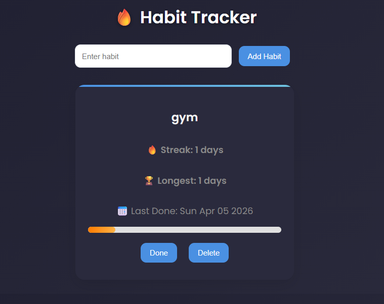

# Habit Tracker

A simple web application for building habits: add a habit, mark it done once a day, and keep the streak going.

**Live demo:** https://pro-habit-tracker-bb9c8.web.app

## Overview

Habit Tracker is a front-end web app built with plain HTML, CSS and JavaScript (ES modules) - no framework and no build step. Habit data is stored in Firebase Firestore, and the app is deployed on Firebase Hosting.

## Features

- Add and delete habits
- Mark a habit as done once per day - a second attempt on the same day is blocked
- Daily streak counter that continues on consecutive days and resets after a gap
- Longest streak record for each habit
- Last completed date shown per habit
- Progress bar showing how far a habit is towards a 7-day cycle
- Empty-state message when no habits have been added yet
- Data persisted in Firebase Firestore

## Technologies

| Layer | Technology |
| --- | --- |
| Structure | HTML |
| Styling | CSS |
| Logic | JavaScript (ES modules) |
| Database | Firebase Firestore |
| Hosting | Firebase Hosting |

## Screenshots

**Main interface**



**Habit list with streaks and progress**


## How to run locally

The app uses ES modules, so it must be served over HTTP - opening `index.html` directly from the file system will not work.

```
git clone https://github.com/archana-kadaralli/pro-habit-tracker.git
cd pro-habit-tracker
python -m http.server 8000
```

Then open http://localhost:8000 in your browser.

Any static file server works, for example `npx serve .`.

## Firebase setup

To run the app against your own Firebase project:

1. Create a project at https://console.firebase.google.com and add a Web app.
2. Enable Cloud Firestore.
3. Copy your web app configuration into `firebase.js` (replace the existing config object).
4. Optionally deploy with Firebase Hosting:

```
npm install -g firebase-tools
firebase login
firebase init hosting   # public directory: .
firebase deploy --only hosting
```

Note: `firebase.js` contains Firebase **web app** configuration (project identifiers used by the browser client), not private server credentials. When you create your own project, set Firestore security rules appropriately for your data.

## Project structure

```
pro-habit-tracker/
├── index.html      # Page structure and input controls
├── style.css       # Styling
├── script.js       # App logic: CRUD, streaks, progress bar
├── firebase.js     # Firebase initialisation and Firestore connection
├── firebase.json   # Firebase Hosting configuration
├── .firebaserc     # Default Firebase project id
├── 404.html        # Hosting 404 page
├── ss1.png         # Screenshot: main interface
└── ss2.png         # Screenshot: habit list with streaks
```

## Author

Archana Kadaralli

- GitHub: [archana-kadaralli](https://github.com/archana-kadaralli)
- LinkedIn: [archana-kadaralli](https://www.linkedin.com/in/archana-kadaralli-2392a2400/)